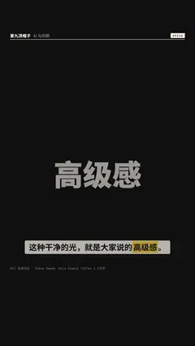

# `shine` · 光泽扫过 (Shine / CC Light Sweep) on a title

 

**怎么动**：a bright band travels across the glyphs once.

| 项 | 内容 |
|---|---|
| 类别 | 字效 |
| 适合的句子 | 收尾、品牌 |
| 建议时长 | 2–3 秒 |
| 参数 | — |
| 横屏 / 竖屏 | ✓ / ✓（尺寸用 vmin，竖屏自动缩放） |
| 人气依据 | Gold Simple Titles 1.1万份 |

```json
{
 "scene": "fx",
 "fx": "shine",
 "theme": "ink",
 "topic": "AI 与判断",
 "text": "高级感",
 "line": "这种干净的光，就是大家说的*高级感*。",
 "t": "@关键词"
}
```

**已知坑**：无
