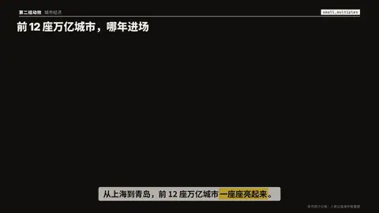

# `small_multiples` · 小倍数图

 

**怎么动**：最多 12 张小图用同一个刻度排成 3 × 4 网格，按阅读顺序一张张画出来；然后挑出一张——强调色描边、其他变淡，9:16 里它放大成字幕带下方的整宽大图，背后是 12 张加起来的总量。

| 项 | 内容 |
|---|---|
| 类别 | 数据 |
| 适合的句子 | 很多个对象各自的走势、「一座座亮起来」 |
| 建议时长 | 5 秒左右 |
| 参数 | `charts`（必填，4–12 个 {name, values, note}）、`kind`（bars / line）、`hl`（名字或序号）、`at`、`title`、`note` |
| 横屏 / 竖屏 | ✓ / ✓（竖屏：网格在字幕带上方，放大图在下方铺到底边；横屏 4 × 3 网格） |
| 跟风格换皮 | 颜色只用风格的 token（--bg --fg --muted --accent --card --card-fg），字体用风格的 display / body / num；没写 `theme` 时画在风格自己的底色上 |
| 什么时候用 | 看形状的相似和例外 |
| 什么时候不用 | 需要读出具体数值；对象少于 4 个 |
| 同步口播 | 有字级时间戳（meta.words）时，条目 / 关键时刻落在说到它的那一刻；`at` 可以写 `"@词"` 或拍内秒数 |
| 缺内容 | 必填参数缺了会直接报错（不会画空骨架）；确实要骨架时写 `"skeleton": true` |

```json
{
 "scene": "fx",
 "fx": "small_multiples",
 "topic": "城市经济",
 "title": "前 12 座万亿城市，哪年进场",
 "note": "每格 2006–2023 · 亮起 = GDP 过万亿",
 "charts": [
  {
   "name": "上海",
   "note": "2006",
   "values": [
    1,
    1,
    1,
    1,
    1,
    1,
    1,
    1,
    1,
    1,
    1,
    1,
    1,
    1,
    1,
    1,
    1,
    1
   ]
  },
  {
   "name": "北京",
   "note": "2008",
   "values": [
    0,
    0,
    1,
    1,
    1,
    1,
    1,
    1,
    1,
    1,
    1,
    1,
    1,
    1,
    1,
    1,
    1,
    1
   ]
  },
  "…"
 ],
 "hl": "深圳",
 "line": "从上海到青岛，前 12 座万亿城市*一座座亮起来*。",
 "src": "各市统计公报；人民日报海外版整理",
 "t": "@关键词"
}
```

**已知坑**：所有小图共用一个最大值，形状才可比。
