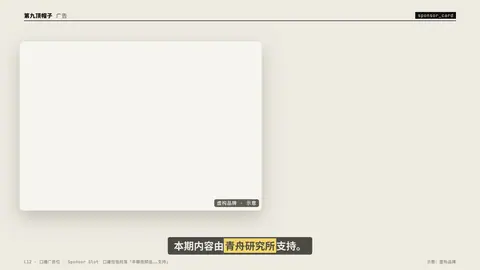
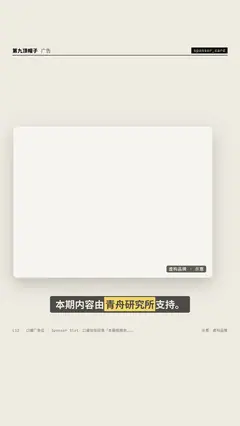

# `sponsor_card` · 

 

**怎么动**：

| 项 | 内容 |
|---|---|
| 类别 | 类型 |
| 适合的句子 | 口播广告位、恰饭段落 |
| 建议时长 | 4–6 秒（圆环按拍长倒数） |
| 参数 | `ad_tag`, `code`, `code_label`, `cta`, `host`, `image`, `lead`, `logo`, `note`, `points`, `sponsor`, `title` |
| 横屏 / 竖屏 | ✓ / ✓（尺寸用 vmin，竖屏自动缩放） |
| 人气依据 | 口播恰饭段落「本期视频由……支持」 |

```json
{
 "scene": "fx",
 "fx": "sponsor_card",
 "theme": "paper",
 "topic": "广告",
 "sponsor": "青舟研究所",
 "points": [
  "一周一份行业研报",
  "数据全部可溯源",
  "新用户首月免费"
 ],
 "code": "HAT9",
 "cta": "链接在评论区第一条",
 "note": "虚构品牌 · 示意",
 "host": true,
 "line": "本期内容由*青舟研究所*支持。",
 "src": "示意：虚构品牌",
 "t": "@关键词"
}
```

**已知坑**：引导语参数叫 lead（label 是画廊页脚）；广告角标始终显示，不能关。
