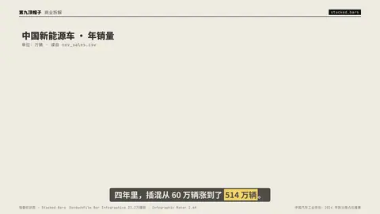
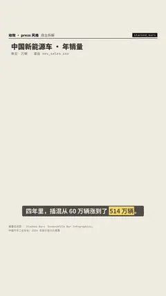

# `stacked_bars` · 

 

**怎么动**：

| 项 | 内容 |
|---|---|
| 类别 | 数据 |
| 适合的句子 | 构成变化、占比 |
| 建议时长 | 4–5 秒 |
| 参数 | `compact`, `csv`, `dec`, `hl`, `note`, `orient`, `percent`, `title`, `total_col`, `totals`, `unit`, `x` |
| 横屏 / 竖屏 | ✓ / ✓（尺寸用 vmin，竖屏自动缩放） |
| 人气依据 | SonduckFilm Bar Infographics 23.2万播放 · Infographic Maker 2.6K |

```json
{
 "scene": "fx",
 "fx": "stacked_bars",
 "theme": "paper",
 "topic": "商业拆解",
 "csv": "assets/nev_sales.csv",
 "x": "年份",
 "series_cols": [
  "纯电动",
  "插电混动"
 ],
 "hl": "插电混动",
 "unit": "万辆",
 "dec": 1,
 "title": "中国新能源车 · 年销量",
 "note": "单位：万辆 · 读自 nev_sales.csv",
 "line": "四年里，插混从 60 万辆涨到了 *514 万辆*。",
 "src": "中国汽车工业协会；2024 年拆分按占比推算",
 "total_col": "合计",
 "t": "@关键词"
}
```

**已知坑**：无
