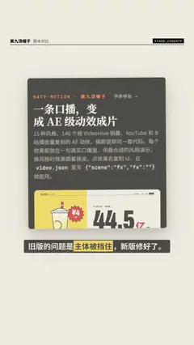

# `stamp_compare` · 截图标注对比

 

**怎么动**：真实截图上画干净的标注：矩形或椭圆框住问题，旁边盖一个「× 问题」章；有新版图时箭头画过去，新版的修好处用强调色框出，再一个个叠上 ✓ 标签。干净的界面标注，不是手绘（手绘用 `scribble`）。

| 项 | 内容 |
|---|---|
| 类别 | 重点信息（贴在主体旁） |
| 适合的句子 | 版本对比、「旧版的问题是……」、指出截图里的一个数字或一块区域 |
| 建议时长 | 4–5 秒 |
| 参数 | `image`（旧图）、`box`（0–1 或像素）、`mark`（rect / circle）、`stamp`、`before_label`、`after`、`after_box`、`after_label`、`checks`（0–5）、`box_at`、`after_at`、`check_at`、`mock` |
| 横屏 / 竖屏 | ✓ / ✓（竖屏：两张竖图并排、标签排在下面；横图上下排） |
| 跟风格换皮 | 字体、强调色、圆角、描边、阴影、重点词的标法（色块 / 下划线 / 马克笔 / 墨晕）都从风格来（`scripts/h9/fx/_kinfo.py` 的 `SKINS`） |
| 章节底色 | beat 没写 `theme` 时，颜色跟着这一章的 `chapter.bg` 颜色世界走（`scripts/h9/device.py`），深色、浅色、强调色章节都可读；在主持人区域里（`presenter.py`）按区域大小排版 |
| 参考 | 抖音开源竖屏模板宣传片（douyin 7701488753897917723）的同类版式 |

截图永远完整显示（不裁），框的坐标按原图算；没有图时用骨架屏代替并标「示意」。

```json
{
 "scene": "fx",
 "fx": "stamp_compare",
 "d": 5.0,
 "theme": "paper",
 "topic": "版本对比",
 "image": "../ui_capture/assets/gallery/gallery-screen.jpg",
 "box": [
  0.03,
  0.62,
  0.94,
  0.36
 ],
 "stamp": "被挡住",
 "after": "../ui_capture/assets/repo/repo-screen.jpg",
 "after_box": [
  0.03,
  0.2,
  0.94,
  0.16
 ],
 "checks": [
  "稳定",
  "聚焦"
 ],
 "line": "旧版的问题是*主体被挡住*，新版修好了。"
}
```
