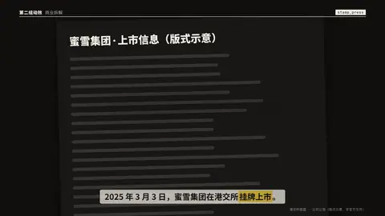
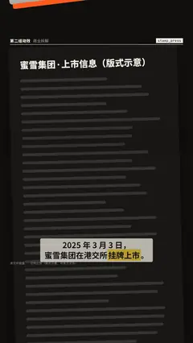

# `stamp_press` · 盖章

 

**怎么动**：一枚印章悬在文件上方，然后砸下来——章身压扁、整屏一震——再抬走，留下带粗糙斑驳质感（湍流侵蚀的油墨）的印记：结论、日期、总数。砸下的时刻 = 口播说出那个词的时刻。

| 项 | 内容 |
|---|---|
| 类别 | 有机质感 |
| 适合的句子 | 「已上市」「驳回」「完成」、一个定论或日期 |
| 建议时长 | 4–5 秒 |
| 参数 | `text`（必填）、`sub`（日期 / 金额）、`title`（文件抬头）、`shape`（rect / round）、`tilt`（角度，默认 −7°）、`at` |
| 横屏 / 竖屏 | ✓ / ✓（竖屏：文件纸从页眉下一直出底边，印在字幕带上方；横屏纸居中） |
| 跟风格换皮 | 颜色只用风格的 token（--bg --fg --muted --accent --card --card-fg），字体用风格的 display / body / num；没写 `theme` 时画在风格自己的底色上 |
| 什么时候用 | 宣判、定性、盖棺定论 |
| 什么时候不用 | 不确定的说法（印章语气太重） |
| 同步口播 | 有字级时间戳（meta.words）时，条目 / 关键时刻落在说到它的那一刻；`at` 可以写 `"@词"` 或拍内秒数 |
| 缺内容 | 必填参数缺了会直接报错（不会画空骨架）；确实要骨架时写 `"skeleton": true` |

```json
{
 "scene": "fx",
 "fx": "stamp_press",
 "topic": "商业拆解",
 "title": "蜜雪集团 · 上市信息（版式示意）",
 "text": "已上市",
 "sub": "2025.03.03 · 港交所",
 "line": "2025 年 3 月 3 日，蜜雪集团在港交所*挂牌上市*。",
 "src": "港交所披露 · 公司公告（版式示意，非官方文件）",
 "shape": "round",
 "t": "@关键词"
}
```

**已知坑**：印记的斑驳每次构建随机种子固定，结果可复现。
