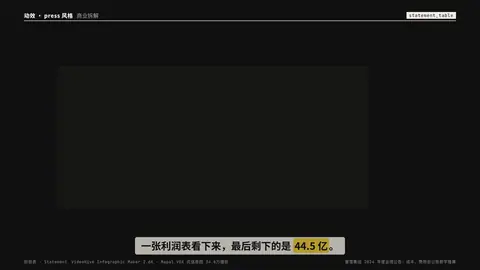
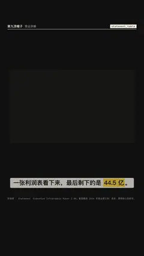

# `statement_table` · 

 

**怎么动**：

| 项 | 内容 |
|---|---|
| 类别 | 数据 |
| 适合的句子 | 利润表 / 资产负债表里的一行 |
| 建议时长 | 4–5 秒 |
| 参数 | `dec`, `hl`, `hl_note`, `period`, `title`, `unit` |
| 横屏 / 竖屏 | ✓ / ✓（尺寸用 vmin，竖屏自动缩放） |
| 人气依据 | VideoHive Infographic Maker 2.6K · Mapal VOX 式信息图 34.6万播放 |

```json
{
 "scene": "fx",
 "fx": "statement_table",
 "theme": "ink",
 "topic": "商业拆解",
 "title": "蜜雪集团 · 利润表（摘要）",
 "period": "截至 2024 年 12 月 31 日止年度",
 "unit": "人民币亿元",
 "cols": [
  "2024"
 ],
 "items": [
  {
   "label": "营业收入",
   "value": 248.3,
   "yoy": "+22.3%"
  },
  {
   "label": "销售成本",
   "value": -167.7,
   "indent": 1
  },
  {
   "label": "毛利",
   "value": 80.6,
   "kind": "sub",
   "yoy": "+34.4%"
  },
  {
   "label": "费用、税项及其他",
   "value": -36.1,
   "indent": 1
  },
  {
   "label": "净利润",
   "value": 44.5,
   "kind": "total",
   "yoy": "+39.8%"
  }
 ],
 "hl": "净利润",
 "hl_note": "净利率 17.9%",
 "line": "一张利润表看下来，最后剩下的是 *44.5 亿*。",
 "src": "蜜雪集团 2024 年度业绩公告；成本、费用由公告数字推算",
 "t": "@关键词"
}
```

**已知坑**：负数写成负值即可，显示时自动加括号；值单位用 unit 写明。
