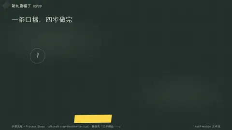
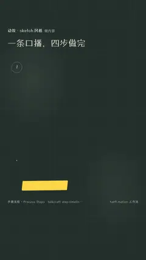

# `steps` · 

 

**怎么动**：

| 项 | 内容 |
|---|---|
| 类别 | 结构 |
| 适合的句子 | 教程、流程、「三步做出……」 |
| 建议时长 | 每步 0.6–1 秒 + 1 秒 |
| 参数 | `hl`, `items`, `title` |
| 横屏 / 竖屏 | ✓ / ✓（尺寸用 vmin，竖屏自动缩放） |
| 人气依据 | talkcraft step-timeline-vertical · 教程类「三步做出……」 |

```json
{
 "scene": "fx",
 "fx": "steps",
 "theme": "ink",
 "topic": "做内容",
 "title": "一条口播，四步做完",
 "items": [
  [
   "写稿",
   "冲突放在第一句"
  ],
  [
   "配音",
   "逐字时间戳"
  ],
  [
   "分镜",
   "一句一个画面"
  ],
  [
   "渲染",
   "横竖屏各一版"
  ]
 ],
 "line": "用九帽动效做一条口播，只要*四步*。",
 "src": "hat9-motion 工作流",
 "t": "@关键词"
}
```

**已知坑**：无
