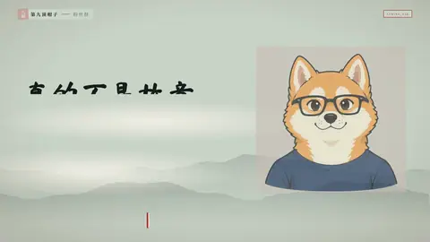
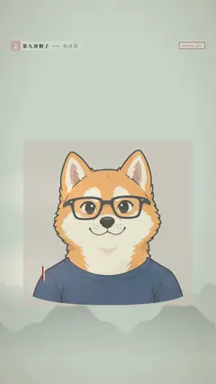

# `strike_fix` · 删除线改口

 

**怎么动**：一句话落下后，其中一个词被划掉、往下沉，改正的词带插入符写在它上方，像校对稿。删除线按风格画：实心条、墨笔、胶带、像素条、细线。

| 项 | 内容 |
|---|---|
| 类别 | 重点信息（贴在主体旁） |
| 适合的句子 | 口误式的改口、「不是……是……」、「动效不是越多越好」 |
| 建议时长 | 3–4 秒 |
| 参数 | `text`（`~~词~~` 标要划掉的部分）、`fix`、`kicker`、`sub`、`chip`（主体上的状态签，如「要配得上口播」）、`at`、`subject` / `video` / `image` |
| 横屏 / 竖屏 | ✓ / ✓（竖屏：字在上，主体卡在下） |
| 跟风格换皮 | 字体、强调色、圆角、描边、阴影、重点词的标法（色块 / 下划线 / 马克笔 / 墨晕）都从风格来（`scripts/h9/fx/_kinfo.py` 的 `SKINS`） |
| 章节底色 | beat 没写 `theme` 时，颜色跟着这一章的 `chapter.bg` 颜色世界走（`scripts/h9/device.py`），深色、浅色、强调色章节都可读；在主持人区域里（`presenter.py`）按区域大小排版 |
| 参考 | 抖音开源竖屏模板宣传片（douyin 7701488753897917723）的同类版式 |

没有主体时：右边多一栏校对页边，划掉的词和改正的词再写一遍。

```json
{
 "scene": "fx",
 "fx": "strike_fix",
 "d": 4.0,
 "theme": "lemon",
 "topic": "动效数量",
 "subject": "../mixue/assets/video/shiba.webm",
 "text": "动效~~越多越好~~",
 "fix": "光多是不够的",
 "chip": "要配得上口播",
 "sub": "More effects is not the point",
 "line": "动效不是越多越好，*光多是不够的*。"
}
```
