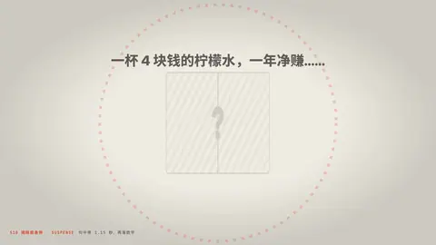

# `suspense` · 

 

**怎么动**：

| 项 | 内容 |
|---|---|
| 类别 | 节奏 |
| 适合的句子 | 「答案是……」揭晓数字 |
| 建议时长 | 悬停 1–3 秒最佳 |
| 参数 | `countdown`, `dec`, `q`, `reveal`, `sub`, `unit`, `value` |
| 横屏 / 竖屏 | ✓ / ✓（尺寸用 vmin，竖屏自动缩放） |
| 人气依据 | 句中停 1.15 秒，再落数字 |

```json
{
 "scene": "fx",
 "fx": "suspense",
 "at": "@四十四亿",
 "theme": "paper",
 "q": "一杯 4 块钱的柠檬水，一年净赚……",
 "value": 44.5,
 "unit": "亿",
 "dec": 1,
 "sub": "蜜雪集团 2024 年净利润",
 "src": "蜜雪集团 2024 年度业绩公告",
 "t": "@关键词"
}
```

**已知坑**：揭晓用 at: "@词"，否则在 62% 处。
