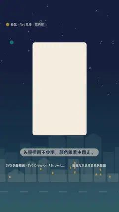

# `svg_art` · 

 

**怎么动**：

| 项 | 内容 |
|---|---|
| 类别 | 照片 |
| 适合的句子 | 图标、插画、品牌色切换 |
| 建议时长 | 4–5 秒（带 swap） |
| 参数 | `accent`, `bg`, `caption`, `draw`, `fg`, `recolor`, `src`, `svg`, `swap`, `title` |
| 横屏 / 竖屏 | ✓ / ✓（尺寸用 vmin，竖屏自动缩放） |
| 人气依据 | 「Stroke Logo Animation」128.5 万 · SonduckFilm Stroke Logo Reveal 66.7 万 |

```json
{
 "scene": "fx",
 "fx": "svg_art",
 "theme": "paper",
 "topic": "做内容",
 "svg": "assets/cup.svg",
 "swap": "ink",
 "title": "矢量插画|永远清晰",
 "caption": "颜色跟着主题走：同一张 SVG，换成深色主题",
 "line": "矢量插画不会糊，*颜色跟着主题走*。",
 "src": "插画为本仓库自绘矢量图",
 "t": "@关键词"
}
```

**已知坑**：自动换色按最深色 → 字色、最饱和色 → 强调色；颜色写在 CSS class 里的 SVG 不会被换色。
