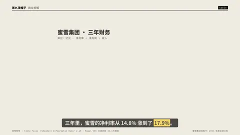
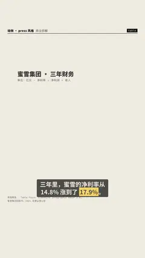

# `table` · 

 

**怎么动**：

| 项 | 内容 |
|---|---|
| 类别 | 数据 |
| 适合的句子 | 多年财务、对比清单、参数表 |
| 建议时长 | 3.5–5 秒 |
| 参数 | `compact`, `header`, `hl_cell`, `hl_col`, `hl_row`, `max_rows`, `note`, `paren`, `title`, `transpose` |
| 横屏 / 竖屏 | ✓ / ✓（尺寸用 vmin，竖屏自动缩放） |
| 人气依据 | VideoHive Infographic Maker 2.6K · Mapal VOX 式信息图 34.6万播放 |

```json
{
 "scene": "fx",
 "fx": "table",
 "theme": "paper",
 "topic": "商业拆解",
 "title": "蜜雪集团 · 三年财务",
 "note": "单位：亿元 · 净利率 = 净利润 ÷ 收入",
 "rows": [
  [
   "年份",
   "收入",
   "净利润",
   "净利率"
  ],
  [
   "2022",
   "135.8",
   "20.1",
   "14.8%"
  ],
  [
   "2023",
   "203.0",
   "31.9",
   "15.7%"
  ],
  [
   "2024",
   "248.3",
   "44.5",
   "17.9%"
  ]
 ],
 "hl_row": "2024",
 "line": "三年里，蜜雪的净利率从 14.8% 涨到了 *17.9%*。",
 "src": "蜜雪集团招股书；2024 年度业绩公告",
 "t": "@关键词"
}
```

**已知坑**：行数超过上限会折叠；高亮用首列文字比用序号稳。
