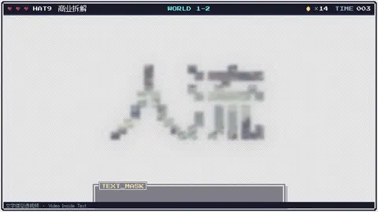
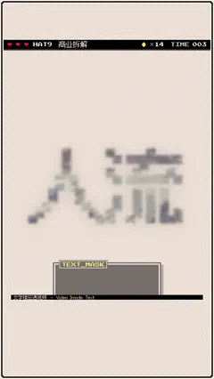

# `text_mask` · 

 

**怎么动**：

| 项 | 内容 |
|---|---|
| 类别 | 照片 |
| 适合的句子 | 一个关键词 + 实拍，转场进入画面 |
| 建议时长 | 3 秒（多图每张 ≥ 0.15 秒） |
| 参数 | `image`, `images`, `sub`, `text` |
| 横屏 / 竖屏 | ✓ / ✓（尺寸用 vmin，竖屏自动缩放） |
| 人气依据 | SonduckFilm「5 Quick Text Effects」76.7万播放 · Mixkit Video Mask Title |

```json
{
 "scene": "fx",
 "fx": "text_mask",
 "theme": "paper",
 "topic": "商业拆解",
 "image": "assets/broll/crossing.jpg",
 "text": "人流",
 "sub": "foot traffic",
 "line": "开店的生意，最后都回到两个字：*人流*。",
 "t": "@关键词"
}
```

**已知坑**：多图时每张图在字里切换；没有图时用强调色渐变填字、不做穿透。
