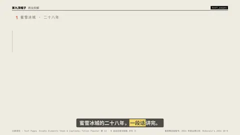
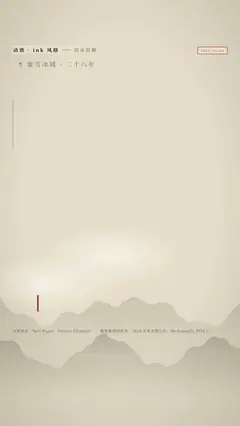

# `text_pages` · 

 

**怎么动**：

| 项 | 内容 |
|---|---|
| 类别 | 字效 |
| 适合的句子 | 一段话要完整读完（背景介绍、原文、长引用、外文原句） |
| 建议时长 | 每句 1.2–2 秒（80–200 字约 6–12 秒，按口播） |
| 参数 | `at`, `dir`, `pages`, `paragraph`, `text`, `title`, `trans`, `translation` |
| 横屏 / 竖屏 | ✓ / ✓（尺寸用 vmin，竖屏自动缩放） |
| 人气依据 | Envato Elements「Hook & Captions」Titles Popular 第 12 · B 站动态歌词排版 898 万 |

```json
{
 "scene": "fx",
 "fx": "text_pages",
 "theme": "paper",
 "topic": "商业拆解",
 "title": "蜜雪冰城 · 二十八年",
 "text": "蜜雪冰城 1997 年从郑州的一个刨冰摊起家。到 2024 年底，全球门店 46,479 家，比麦当劳还多。2024 年收入 248.3 亿元，净利润 44.5 亿元。收入里 97.5% 来自卖给加盟店的原料、包材和设备，加盟费只占 2.5%。",
 "line": "蜜雪冰城的二十八年，*一段话*讲完。",
 "src": "蜜雪集团招股书；2024 年度业绩公告；McDonald's 2024 10-K",
 "t": "@关键词"
}
```

**已知坑**：长段落用 at 和口播逐句对齐；阿拉伯文 / 希伯来文目前用系统字体。
