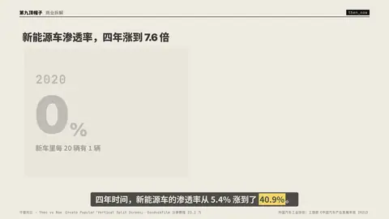
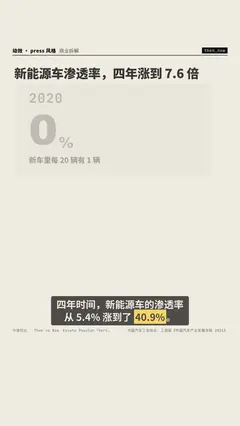

# `then_now` · 

 

**怎么动**：

| 项 | 内容 |
|---|---|
| 类别 | 数据 |
| 适合的句子 | 今昔对比、前后变化 |
| 建议时长 | 4–5 秒 |
| 参数 | `change`, `dec`, `now`, `then` |
| 横屏 / 竖屏 | ✓ / ✓（尺寸用 vmin，竖屏自动缩放） |
| 人气依据 | Envato Popular「Vertical Split Screen」· SonduckFilm 分屏教程 23.2 万 |

```json
{
 "scene": "fx",
 "fx": "then_now",
 "theme": "paper",
 "topic": "商业拆解",
 "title": "新能源车渗透率，四年涨到 7.6 倍",
 "then": {
  "label": "2020",
  "value": 5.4,
  "unit": "%",
  "caption": "新车里每 20 辆有 1 辆"
 },
 "now": {
  "label": "2024",
  "value": 40.9,
  "unit": "%",
  "caption": "新车里每 5 辆有 2 辆"
 },
 "line": "四年时间，新能源车的渗透率从 5.4% 涨到了 *40.9%*。",
 "src": "中国汽车工业协会；工信部《中国汽车产业发展年报 2021》",
 "t": "@关键词"
}
```

**已知坑**：两个数字口径要一致（同一指标、同一单位）。
