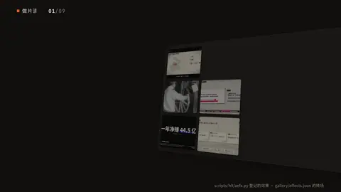
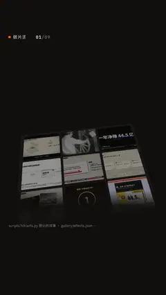

# `tilt_board` · 组件墙 · Tilt Board

 

**怎么动**：一块倾斜的三维面板上排满小卡片，一行行（竖屏是一列列）朝面板远端不停地流走，旁边一个大计数器从 0 往上数。每数到第 k 步，就有一张新卡片从上方落到面板的空位里，落地压扁 4 帧再弹回，影子跟着收紧。计数器用等宽数字，数完停住，面板继续流动。

| 项 | 内容 |
|---|---|
| 类别 | 流程 · 数字变形状 |
| 适合的句子 | 「我把好看的画面拆成了 400 个组件」「一年攒了 1,000 多张图」 |
| 建议时长 | 5–7 秒 |
| 横屏 / 竖屏 | ✓ / ✓（两种构图，见下） |

**参数**

| 参数 | 类型 | 默认 | 说明 |
|---|---|---|---|
| `value` | 整数或文字（必填） | — | 整数会数上去；「400+」「2.6万」这种数字带短尾巴的，数字部分数、尾巴不动；不是数字（「很多很多」）就原样显示，面板照样动 |
| `unit` | 文字 | `"个组件"` | 单位 |
| `title` | 文字 | 无 | 标题，最多两行，放不下自动缩小再省略 |
| `index` | 文字 | 无 | 标题前的小编号，如 `"03"` |
| `media` | 图片 / 视频列表 | 无 | 卡片上的真实画面（视频取一帧，动图取第一帧），不够就循环；不给时画五种风格色的骨架卡：图表、文字块、窗口、引语、数字 |
| `rows` | 整数 1–6 | 3 | 面板上有几道（横屏是行，竖屏是列） |

**横屏 vs 竖屏**

- 16:9：编号、标题（≥ 56 px）、计数器（字形高约 174 px）、进度条和单位竖排在左栏（x 110 起，宽 600）；面板绕右边缘转 −22°、前倾 8°，从 x 约 760 一直伸出画面右边，左端远、右端近，卡片向左（远处）流走。
- 9:16：标题在 y 296 起，计数器在 y 420–620（单位 ≥ 48 px 跟在数字后面），面板后仰 38°、转 −8°，从 y 约 650 铺到画面底部、伸出右下角，卡片一列列往上（远处）流走；面板在 y 1236–1340 渐隐进页面底色（之下 94%），字幕所在的区域是干净的底，对比度 ≥ 7:1。
- 1:1 / 4:5 / 3:4 用竖屏构图缩放。

**跟风格换皮**：面板是前景色 7% 叠在底色上，点阵底纹；卡片用风格的卡片色、圆角（上限 18 px）和阴影；骨架卡的强调块、编号、单位和进度条用强调色（不够醒目时换前景色）；数字用风格的数字字体。

```json
{
 "scene": "fx",
 "fx": "tilt_board",
 "value": 400,
 "unit": "个组件",
 "title": "好看的画面，拆成组件",
 "index": "03",
 "line": "我把好看的画面拆成了 400 个组件。"
}
```

**已知坑**：数字很长（如 1,234,567）时为了不压到面板会按栏宽缩小，字形高度低于 170 px；想要更大就把单位换大（「123 万」）。`value` 为 0 时计数器不动，卡片仍按时间落下。

**实现**：`scripts/h9/fx/fx4_flow.py`。
