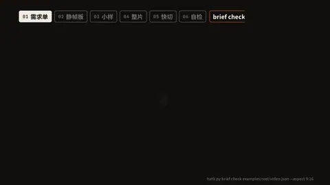
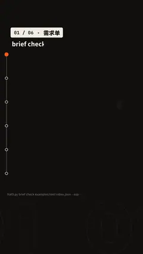

# `time_budget` · 一天的账 · Time Budget

 

**怎么动**：一个粗圆环就是一整天（中间是大字 `total`）。`mine` 是从 12 点开始顺时针的一小段强调色切片，**角度按真实比例算**（30 分钟 / 24 小时 = 7.5°），一根引线拉到外面的标签。剩下的圆环分成 24 − x 段，先顺时针铺好；然后前 `units` 段一段一段填满（每段 3 帧，段尾闪一下刻度），一根表针领着填充的前沿走；每填一段，就有一张成品落下来：横屏落到右边的两列成品塔上（自下而上堆，落地压扁 4 帧），竖屏从圆环底部沿弧线发进下面的扇形牌里（从左到右）。最后 `count` 像印章一样盖下来。停住时表针继续慢慢绕圈，切片标签轻轻呼吸（2%）。

| 项 | 内容 |
|---|---|
| 类别 | 流程 · 数字变形状 |
| 适合的句子 | 「一天 24 小时，我只花 30 分钟，剩下的全交给 AI」「我只管开头这一下，后面它自己跑」 |
| 建议时长 | 5–7 秒（`units` 多时取长） |
| 横屏 / 竖屏 | ✓ / ✓（两种构图，见下） |

**参数**

| 参数 | 类型 | 默认 | 说明 |
|---|---|---|---|
| `mine` | 文字 | `"30 分钟"` | 我自己花的时间（读得懂 小时 / 分钟 / 秒 / 天 / h / min / 半小时 / 两天…） |
| `total` | 文字 | `"24 小时"` | 整个周期；数字部分做大字，单位排在下面 |
| `mine_label` | 文字 | `"我"` | 切片标签前半（强调色） |
| `rest_label` | 文字 | `"剩下的，全交给 AI"` | 圆环其余部分的说明；写 `""` 不显示 |
| `units` | 整数 0–24 | 0（给了 `thumbs` 时 = 图的张数） | 剩下的部分有几段要填满；超过段数时按段数填并提示 |
| `thumbs` | 图片 / 视频列表 | 无 | 每填一段落下的成品（视频取一帧，动图取第一帧）；不够就循环；不给时画成风格色的「成品卡」 |
| `count` | 文字 | 无 | 最后盖下的印章，如「一天 5–10 期」 |

**横屏 vs 竖屏**

- 16:9：圆环在左（中心 (600, 500)，半径 310，环宽 46，中间大字字形高约 190 px），标签（≥ 44 px）在环顶右侧；右边 x 1160–1780 是两列 290×163 的成品塔，自下而上长（超过 8 张时按行压扁）；`rest_label`（≥ 48 px）在环下，`count` 印章（≥ 60 px）在塔下。没有要填的段时，右半边换成大字 `rest_label` + `count`。
- 9:16：圆环在上（中心 y 650，半径 318，环宽 46），标签（≥ 44 px）在环顶右侧、页眉下面；环下一行 `rest_label`（≥ 52 px），`count` 印章紧跟在它下面；再下面是从左到右发出来的扇形牌（440×782 竖牌，x 40–1040，最多 7 个位置，再多就叠在同一位置上面），一直铺到画面底边之外；成品从环底沿弧线飞过去，和横屏的「落下」是两条不同的运动路线。
- 1:1 / 4:5 / 3:4 用竖屏构图缩放。

**读不出时间**：`mine` / `total` 不是「数字 + 单位」，或 `mine` ≥ `total` 时，不画假角度：圆环整圈分 24 段，标签前面只放一个点，把两段文字原样显示，构建时打印一行警告，根节点带 `data-note` 说明原因。

**跟风格换皮**：切片和印章用强调色（强调色在底色上不够醒目时自动换成前景色），已填的段用前景色，未填的段是前景色 13% 叠在底色上；成品卡用风格的卡片色、圆角（上限 18 px）和阴影。

```json
{
 "scene": "fx",
 "fx": "time_budget",
 "total": "24 小时",
 "mine": "30 分钟",
 "units": 12,
 "thumbs": ["assets/previews/reel_16x9.jpg", "assets/previews/minimal_16x9.jpg"],
 "count": "一天 5–10 期",
 "line": "一天 24 小时，我只花 30 分钟。"
}
```

**已知坑**：切片是真实角度，1 分钟 / 24 小时只有 0.25°（切片比环宽 14 px，仍然看得见，但很细）。文字太长时先缩到下限（标签 44 px、`rest_label` 48 / 52 px、印章 60 px），再省略末尾。

**实现**：`scripts/h9/fx/fx4_flow.py`。
