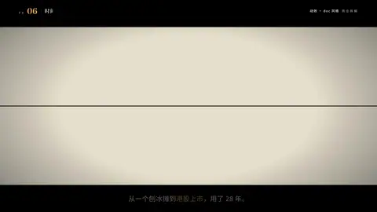

# `timeline` · 

 

**怎么动**：

| 项 | 内容 |
|---|---|
| 类别 | 数据 |
| 适合的句子 | 发展历程、关键年份、复盘 |
| 建议时长 | 每个节点 ≥ 0.5 秒 |
| 参数 | `hl`, `items` |
| 横屏 / 竖屏 | ✓ / ✓（尺寸用 vmin，竖屏自动缩放） |
| 人气依据 | Company Timeline 3.2K（Titles 第 9）· Smertimba 23.9万播放 |

```json
{
 "scene": "fx",
 "fx": "timeline",
 "theme": "paper",
 "topic": "商业拆解",
 "items": [
  [
   "1997",
   "郑州街头的刨冰摊"
  ],
  [
   "1999",
   "启用「蜜雪冰城」"
  ],
  [
   "2007",
   "开放加盟"
  ],
  [
   "2018",
   "雪王诞生 · 首家海外店"
  ],
  [
   "2020",
   "门店破万"
  ],
  [
   "2025",
   "港交所上市"
  ]
 ],
 "line": "从一个刨冰摊到*港股上市*，用了 28 年。",
 "src": "蜜雪集团招股书（港交所披露）",
 "t": "@关键词"
}
```

**已知坑**：无
