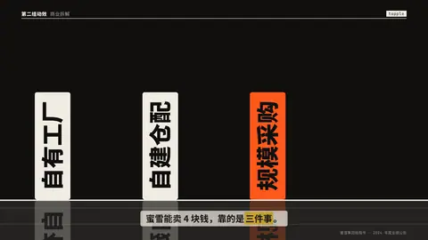
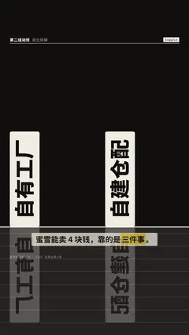

# `topple` · 多米诺推倒

 

**怎么动**：一排高板，每块的侧面竖写一个要点；一个球滚进来碰倒第一块，第一块砸第二块……是真的多米诺链（每块靠在下一块上，不会穿过去，按几何算出来的）；倒平后板上的字从左到右连成一句话。可选 `text`：最后一句大标题砸下来、整屏一震。

| 项 | 内容 |
|---|---|
| 类别 | 物理 |
| 适合的句子 | 「靠的是三件事」「一个接一个」、因果链、连锁反应 |
| 建议时长 | 4–5 秒 |
| 参数 | `items`（必填，2–5 个短语）、`text`（倒完后砸下的大标题）、`hl`（哪块用强调色，默认最后一块）、`title`、`note` |
| 横屏 / 竖屏 | ✓ / ✓（竖屏：板子高 ≥ 500、侧面字 ≥ 110 px，一排倒下比画面宽，镜头跟着多米诺链横移；大标题落进板子腾出的上半屏；横屏一屏放得下） |
| 跟风格换皮 | 颜色只用风格的 token（--bg --fg --muted --accent --card --card-fg），字体用风格的 display / body / num；没写 `theme` 时画在风格自己的底色上 |
| 什么时候用 | 几个要点有先后、或者一个推动下一个 |
| 什么时候不用 | 要点很长（每块只放得下 2–6 个字）；要点之间是并列没有因果（用 list_stack） |
| 同步口播 | 有字级时间戳（meta.words）时，条目 / 关键时刻落在说到它的那一刻；`at` 可以写 `"@词"` 或拍内秒数 |
| 缺内容 | 必填参数缺了会直接报错（不会画空骨架）；确实要骨架时写 `"skeleton": true` |

```json
{
 "scene": "fx",
 "fx": "topple",
 "topic": "商业拆解",
 "items": [
  "自有工厂",
  "自建仓配",
  "规模采购"
 ],
 "line": "蜜雪能卖 4 块钱，靠的是*三件事*。",
 "src": "蜜雪集团招股书 · 2024 年度业绩公告",
 "text": "4 块钱的底气",
 "t": "@关键词"
}
```

**已知坑**：第一块被推的时刻 = 第一项被说出的时刻（没有字级时间戳时在 30% 处）。
