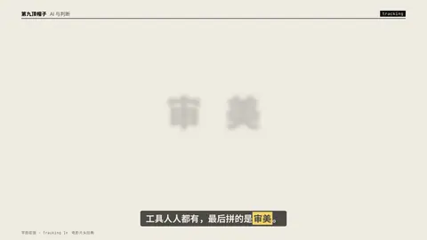

# `tracking` · 字距收拢 (Tracking In)

 

**怎么动**：glyphs start spread wide and drift together while sharpening — done with transforms (x offset ∝ distance from the centre), so it never snaps to whole pixels like letter-spacing would.

| 项 | 内容 |
|---|---|
| 类别 | 字效 |
| 适合的句子 | 电影感标题、一个词 |
| 建议时长 | 2–3 秒 |
| 参数 | `spread`, `sub`, `text` |
| 横屏 / 竖屏 | ✓ / ✓（尺寸用 vmin，竖屏自动缩放） |
| 人气依据 | 电影片头经典 |

```json
{
 "scene": "fx",
 "fx": "tracking",
 "theme": "paper",
 "topic": "AI 与判断",
 "text": "审 美",
 "sub": "TASTE",
 "line": "工具人人都有，最后拼的是*审美*。",
 "host": true,
 "t": "@关键词"
}
```

**已知坑**：无
