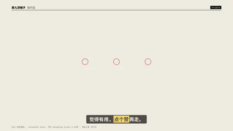
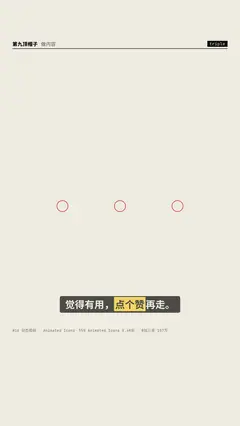

# `triple` · 三连 (like · coin · favourite)

 

**怎么动**：icons pop in sequence, each with a ring burst; the B站/抖音 staple ending.

| 项 | 内容 |
|---|---|
| 类别 | 界面 |
| 适合的句子 | 片尾求三连 / 关注 |
| 建议时长 | 2–3 秒 |
| 参数 | `labels` |
| 横屏 / 竖屏 | ✓ / ✓（尺寸用 vmin，竖屏自动缩放） |
| 人气依据 | 555 Animated Icons 6.4K份 · B站三连 157万 |

```json
{
 "scene": "fx",
 "fx": "triple",
 "theme": "paper",
 "topic": "做内容",
 "line": "觉得有用，*点个赞*再走。",
 "t": "@关键词"
}
```

**已知坑**：无
