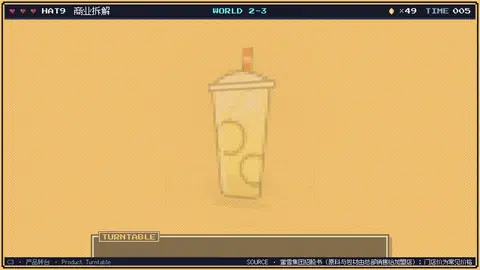
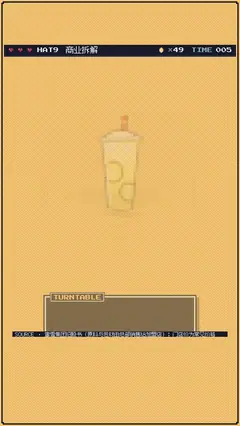

# `turntable` · 

 

**怎么动**：

| 项 | 内容 |
|---|---|
| 类别 | 照片 |
| 适合的句子 | 产品亮相、单品拆解、参数卖点 |
| 建议时长 | 4–6 秒 |
| 参数 | `at`, `image`, `kicker`, `name`, `price`, `specs`, `sway`, `text`, `turns`, `views` |
| 横屏 / 竖屏 | ✓ / ✓（尺寸用 vmin，竖屏自动缩放） |
| 人气依据 | VideoHive Product Promo 分类销量榜 |

```json
{
 "scene": "fx",
 "fx": "turntable",
 "theme": "lemon",
 "topic": "商业拆解",
 "line": "一杯 4 块钱的柠檬水，转一圈看看它*卖的是什么*。",
 "image": "assets/cup.svg",
 "kicker": "蜜雪冰城 · 招牌",
 "name": "冰鲜柠檬水",
 "price": "¥4",
 "specs": [
  "整片柠檬",
  "冰块 + 糖浆 + 茶底",
  "原料和包材都由总部供应",
  "常见门店价 4 元"
 ],
 "src": "蜜雪集团招股书（原料与包材由总部销售给加盟店）；门店价为常见价格",
 "t": "@关键词"
}
```

**已知坑**：单张图是伪 3D 摇摆，不是真转；要真转请给多视角 views。抠图（透明底）效果最好。
