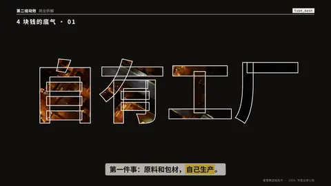
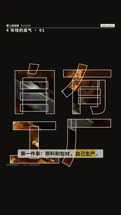

# `type_mask` · 字形窗口

 

**怎么动**：标题巨大，是页面上挖出来的窗口，这一拍的照片或视频透过字形在动；然后镜头扎进一个笔画（按真实字形找到的「最深处」），窗口张开成满屏画面。

| 项 | 内容 |
|---|---|
| 类别 | 字即画面 |
| 适合的句子 | 开章、点题、「第一件事：自己生产」配一段实拍 |
| 建议时长 | 4–5 秒 |
| 参数 | `text`（必填）、`image` / `video` / `subject`（必填）、`focus`、`kicker`（左上小字）、`at`（张开时刻，默认 55%） |
| 横屏 / 竖屏 | ✓ / ✓（竖屏：标题竖着排 2–3 行几乎占满全高；横屏 1–2 行） |
| 跟风格换皮 | 颜色只用风格的 token（--bg --fg --muted --accent --card --card-fg），字体用风格的 display / body / num；没写 `theme` 时画在风格自己的底色上 |
| 什么时候用 | 有一段好画面、又想先让一个词立住 |
| 什么时候不用 | 没有图（会报错）；画面本身很暗或很碎时字形里看不清 |
| 同步口播 | 有字级时间戳（meta.words）时，条目 / 关键时刻落在说到它的那一刻；`at` 可以写 `"@词"` 或拍内秒数 |
| 缺内容 | 必填参数缺了会直接报错（不会画空骨架）；确实要骨架时写 `"skeleton": true` |

```json
{
 "scene": "fx",
 "fx": "type_mask",
 "topic": "商业拆解",
 "text": "自有工厂",
 "image": "../aefx/assets/broll/factory.jpg",
 "kicker": "4 块钱的底气 · 01",
 "line": "第一件事：原料和包材，*自己生产*。",
 "src": "蜜雪集团招股书 · 2024 年度业绩公告",
 "t": "@关键词"
}
```

**已知坑**：张开时缩放约 40–80 倍，字形边缘的描边会先淡出。
