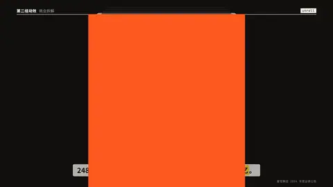

# `unroll` · 卷轴展开

 

**怎么动**：一根横杆上挂着卷轴，带配重的纸卷往下掉、边转边放出纸，半拍之内纸就垂到底边；标题、各行、总数在口播说到它们时一行行印上去（不会早于纸到达那里）。

| 项 | 内容 |
|---|---|
| 类别 | 字即画面 |
| 适合的句子 | 账单、清单、利润表、「248 亿收入，最后剩多少」 |
| 建议时长 | 5 秒左右 |
| 参数 | `text`（顶部标题）、`rows`（0–6 行，[名称, 数值]）、`value` + `unit`（底部大数），text 和 value 至少一个 |
| 横屏 / 竖屏 | ✓ / ✓（竖屏：纸 780 宽从页眉下一直到底边，大数在字幕带上方；横屏纸居中） |
| 跟风格换皮 | 颜色只用风格的 token（--bg --fg --muted --accent --card --card-fg），字体用风格的 display / body / num；没写 `theme` 时画在风格自己的底色上 |
| 什么时候用 | 从上到下读的账、一步步算到一个结果 |
| 什么时候不用 | 要横向比较的数据；行数超过 6 |
| 同步口播 | 有字级时间戳（meta.words）时，条目 / 关键时刻落在说到它的那一刻；`at` 可以写 `"@词"` 或拍内秒数 |
| 缺内容 | 必填参数缺了会直接报错（不会画空骨架）；确实要骨架时写 `"skeleton": true` |

```json
{
 "scene": "fx",
 "fx": "unroll",
 "topic": "商业拆解",
 "text": "2024 年 · 利润表",
 "rows": [
  [
   "营业收入",
   "248.3 亿"
  ],
  [
   "销售成本",
   "−167.7 亿"
  ],
  [
   "费用、税项及其他",
   "−36.1 亿"
  ]
 ],
 "value": "44.5",
 "unit": "亿 净利润",
 "line": "248 亿收入，扣掉成本和费用，落到口袋里的是 *44.5 亿*。",
 "src": "蜜雪集团 2024 年度业绩公告",
 "t": "@关键词"
}
```

**已知坑**：大数自动缩到字幕带以上能放下的大小。
