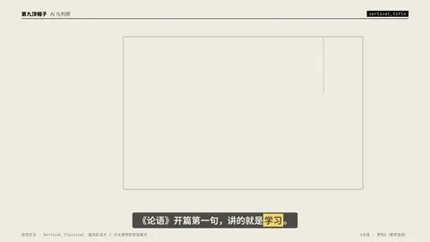
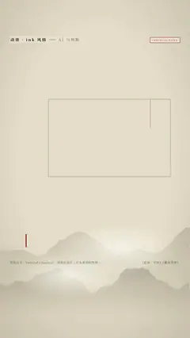

# `vertical_title` · 

 

**怎么动**：

| 项 | 内容 |
|---|---|
| 类别 | 字效 |
| 适合的句子 | 国风片名、古文原句、竖排标题 |
| 建议时长 | title 3–4 秒；classical 5–6 秒 |
| 参数 | `font`, `mode`, `seal`, `sub`, `text` |
| 横屏 / 竖屏 | ✓ / ✓（尺寸用 vmin，竖屏自动缩放） |
| 人气依据 | 国风纪录片 / 片头常用的竖排版式 |

```json
{
 "scene": "fx",
 "fx": "vertical_title",
 "theme": "paper",
 "topic": "AI 与判断",
 "mode": "classical",
 "text": "學而時習之|不亦說乎|有朋自遠方來|不亦樂乎|人不知而不慍|不亦君子乎",
 "sub": "《論語 · 學而》",
 "seal": "論語",
 "line": "《论语》开篇第一句，讲的就是*学习*。",
 "src": "《论语 · 学而》（繁体竖排）",
 "t": "@关键词"
}
```

**已知坑**：古文用通行版本，繁体原文里不要混简体字。
