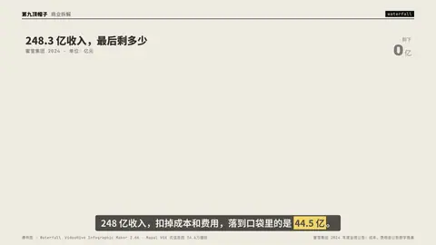
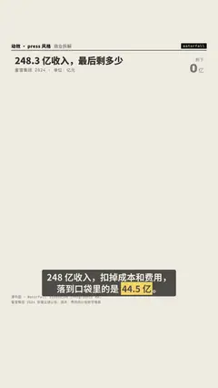

# `waterfall` · 

 

**怎么动**：

| 项 | 内容 |
|---|---|
| 类别 | 数据 |
| 适合的句子 | 从收入一路扣到净利 |
| 建议时长 | 4–6 秒 |
| 参数 | `compact`, `dec`, `note`, `orient`, `readout`, `title`, `unit` |
| 横屏 / 竖屏 | ✓ / ✓（尺寸用 vmin，竖屏自动缩放） |
| 人气依据 | VideoHive Infographic Maker 2.6K · Mapal VOX 式信息图 34.6万播放 |

```json
{
 "scene": "fx",
 "fx": "waterfall",
 "theme": "paper",
 "topic": "商业拆解",
 "title": "248.3 亿收入，最后剩多少",
 "note": "蜜雪集团 2024 · 单位：亿元",
 "unit": "亿",
 "dec": 1,
 "readout": "剩下",
 "steps": [
  [
   "营业收入",
   248.3,
   "start"
  ],
  [
   "销售成本",
   -167.7
  ],
  [
   "毛利",
   null,
   "sub"
  ],
  [
   "费用、税项及其他",
   -36.1
  ],
  [
   "净利润",
   null,
   "end"
  ]
 ],
 "line": "248 亿收入，扣掉成本和费用，落到口袋里的是 *44.5 亿*。",
 "src": "蜜雪集团 2024 年度业绩公告；成本、费用由公告数字推算",
 "t": "@关键词"
}
```

**已知坑**：最后一行留空就自动算合计；kind 用 sub 插小计。
