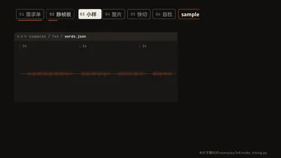
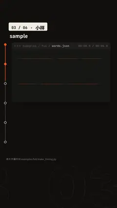

# `wave_align` · 声画对齐

 

**怎么动**：一段配音做成波形窗口（3 px 宽的竖条、2 px 间隔，用风格强调色，按种子固定生成，有音节起伏、句间留静音），播放头匀速从左扫到右，扫过的部分变实色，标题栏右侧时间码跟着走。播放头走到哪一段字幕，那段字幕框就从下方「啪」地弹到它对应的波形区间上（6 帧，带过冲），一条细括号把框和区间连起来。写了 `fix` 时，含错词的那个框抖一下（±6 px，5 帧），错词被划掉、改正后的词从下面滑进来，框的颜色从警示色变成正确色。
横屏：波形窗口铺满宽（x 110–1810，y 220–700），上方有秒刻度，字幕框在窗口下面一排（放不下时自动错成两排），左下角是「纠错 A → B」一行，右下角是标签。竖屏：窗口 x 60–1020、y 300–880，波形拆成上下两条（前半段 / 后半段，竖条仍是 3 px），每条下面挂自己那一排字幕框；窗口下面是一张「字幕 · 自动对齐」卡片（字 ≥ 40 px），每对齐一段就加一行带时间码的字幕（像在生成字幕文件），多了往上滚；卡片一直铺到画面底边之外，字只排到字幕带上方。

| 项 | 内容 |
|---|---|
| 类别 | 流程 · 音频 / 工作流 |
| 适合的句子 | 「配音是我自己的声音，字幕自动对齐，错字顺手改掉」 |
| 建议时长 | 5–7 秒 |
| 参数 | `words`（必填，字幕分段列表，3–10 段；超过 10 段自动把相邻的短段合并）、`title`（标题栏文件名，默认「口播 / 配音.wav」）、`fix`（`{"from": "错词", "to": "正确词"}`，可选）、`chips`（标签，最多 4 个） |
| 横屏 / 竖屏 | ✓ / ✓（两套构图；1:1、4:5、3:4 用竖屏构图缩放） |
| 跟风格换皮 | 波形、括号、播放进度用 --accent；窗口用 --card；错词用风格警示色 |
| 什么时候用 | 讲配音、字幕、对齐、纠错这一步 |
| 什么时候不用 | 要真的播一段别人的音频（用 `audio_quote` / `podcast`） |
| 同步口播 | 片子有逐字时间（`meta.words`）且每段字幕都在这一拍里说到时，按真实时间定每段的宽度和弹出时刻；否则按字数分配 |
| 缺内容 | 没写 `words` 会直接报错；确实要骨架时写 `"skeleton": true` |

```json
{
 "scene": "fx",
 "fx": "wave_align",
 "d": 6,
 "title": "ep21 / 配音.wav",
 "words": ["配音是我自己的声音", "克隆出来的", "字幕按句子", "自动对齐", "照着稿子念一便", "错字顺手改掉"],
 "fix": {"from": "一便", "to": "一遍"},
 "chips": ["本人声音", "自动对齐"],
 "line": "配音是我自己的声音，字幕自动对齐。"
}
```

**已知坑**：波形是示意的（按种子生成），不是真实音频的波形。一段特别长时框会占满它的区间并在必要时省略结尾；`fix` 的错词找不到时只在纠错行里显示。示例里的错词请用中性的例子，不要拿真实产品名打趣。

**实现**：`scripts/h9/fx/fx4_work.py`。
