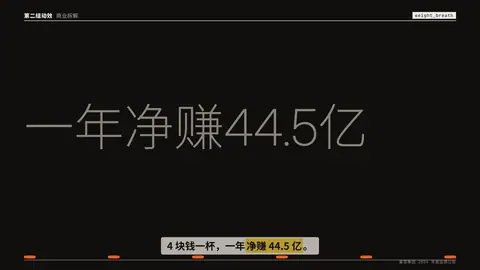
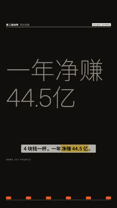

# `weight_breath` · 字重呼吸

 

**怎么动**：标题先是细而灰的；口播说到每个音节时，那个字「吸一口气」：字重从细涨到最粗、宽度拉伸，然后落到粗体，同时底边的音节条跟着跳。风格的标题字体有字重轴时用真可变字重，否则用描边加粗模拟。

| 项 | 内容 |
|---|---|
| 类别 | 字即画面 |
| 适合的句子 | 金句、口号、一句要一字一顿说出来的话 |
| 建议时长 | 3.5–5 秒 |
| 参数 | `text`（必填）、`rate`（没有字级时间戳时每秒几个字，默认 4.4）、`at`、`title`、`note` |
| 横屏 / 竖屏 | ✓ / ✓（竖屏：标题 2–3 行在字幕带上方，音节条在底边；横屏同理） |
| 跟风格换皮 | 颜色只用风格的 token（--bg --fg --muted --accent --card --card-fg），字体用风格的 display / body / num；没写 `theme` 时画在风格自己的底色上 |
| 什么时候用 | 有配音逐字时间戳、一句话本身就是画面 |
| 什么时候不用 | 长段文字；没有口播的段落（节奏会是假的） |
| 同步口播 | 有字级时间戳（meta.words）时，条目 / 关键时刻落在说到它的那一刻；`at` 可以写 `"@词"` 或拍内秒数 |
| 缺内容 | 必填参数缺了会直接报错（不会画空骨架）；确实要骨架时写 `"skeleton": true` |

```json
{
 "scene": "fx",
 "fx": "weight_breath",
 "topic": "商业拆解",
 "text": "一年净赚 44.5 亿",
 "line": "4 块钱一杯，一年*净赚 44.5 亿*。",
 "src": "蜜雪集团 2024 年度业绩公告",
 "t": "@关键词"
}
```

**已知坑**：字级时间戳来自 meta.words；对不上时按 rate 均匀排。
