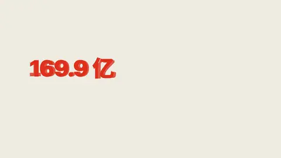
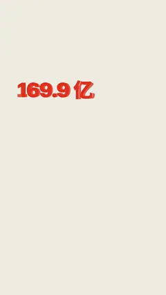

# `wire_resolve` · 线框成形

 

**怎么动**：先是暗下来的底（压暗 55%）上一层发光线框：每张卡片的外框、条形槽和条形按阅读顺序一笔描出来（3 px 强调色线、8 px 光晕，每张卡在亮线扫到之前至少完整停留 0.6 秒），文字是空心描边，后面飘着一层淡淡的代码字符雨。到拍长 40% 时，一道 6 px 的亮线带着 60 px 光晕从上往下扫过（0.7 秒）：线以上是成品卡片（风格自己的卡片底色、文字、阴影），线以下还是线框。最后卡片整体缓慢放大到 1.03，重点卡片上浮 14 px、阴影加深。

| 项 | 内容 |
|---|---|
| 类别 | 结构 |
| 适合的句子 | 2–5 个并列的数「拆开看：国内 93.3 亿，海外 66.7 亿」，从方案到成品、从草图到落地 |
| 建议时长 | 5–6 秒 |
| 参数 | `items`（必填，2–5 张卡片，每张 `{title, value}`，可加 `hero: true`；默认数值最大的那张是重点）、`title`、`note` |
| 横屏 / 竖屏 | ✓ / ✓（竖屏卡片竖排铺满 y 300–1260，标题 40 px、数值 104 px，右侧避开平台按钮区；横屏 2–3 张一排，4–5 张两排，铺满宽度） |
| 跟风格换皮 | 线框和扫描线用 --accent，成品卡片用 --card / --card-fg 和风格的圆角、阴影；强调色在卡片上不够醒目时，重点数值和条形自动换成对比够的颜色 |
| 什么时候用 | 要把一个总数拆开、或展示「搭出来的结构」 |
| 什么时候不用 | 只有一个数；卡片内容是长句子 |
| 数字 | 等宽数字（tabular-nums）；条形长度按值里的数字成真实比例 |
| 缺内容 | 少于 2 张卡片会直接报错；确实要骨架时写 `"skeleton": true` |
| 接转场 | 重点卡片的数值带 `data-anchor="value"`；这一拍写 `"tr": "anchor_match"` 时，重点卡片从第一帧就是成品，接住上一拍带过来的数字 |

```json
{
 "scene": "fx",
 "fx": "wire_resolve",
 "title": "169.9 亿从哪来",
 "items": [{"title": "全年营收", "value": "169.9 亿", "hero": true}, {"title": "国内主品牌", "value": "93.3 亿"}, {"title": "海外主品牌", "value": "66.7 亿"}],
 "line": "拆开看：国内主品牌 93.3 亿，海外 *66.7 亿*。",
 "src": "名创优品 2024 年度业绩公告（港交所 9896）",
 "t": "@关键词"
}
```

**已知坑**：值写成带单位的字符串（"93.3 亿"），条形按其中的数字成比例；卡片超过 5 张会报错。

**实现**：`scripts/h9/fx/fx3_scene.py`。
