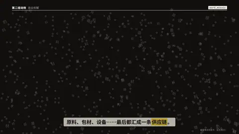
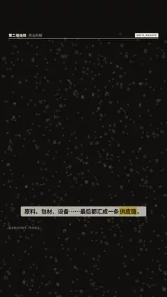

# `word_mosaic` · 字海成形

 

**怎么动**：几百个和这个词有关的小字（`glyphs`）像噪点一样散在整个画面上，然后从左到右飞进标题真实字形的格子里，拼成一块块同尺寸、满对比的字砖，字形清楚地停 0.6 秒以上（底下垫一层 15% 的实心字）（字形用风格的标题字体在构建时栅格化，跟屏幕上一致）；没用上的小字留作一层淡淡的底纹铺到底边。

| 项 | 内容 |
|---|---|
| 类别 | 字即画面 |
| 适合的句子 | 「最后都汇成一条供应链」、由许多个组成一个 |
| 建议时长 | 4–5 秒 |
| 参数 | `text`（必填，建议 2–4 个字）、`glyphs`（相关小字，默认用标题本身）、`at`、`title`、`note` |
| 横屏 / 竖屏 | ✓ / ✓（竖屏：词在字幕带上方，最多 3 行；底纹铺满全屏；横屏同理） |
| 跟风格换皮 | 颜色只用风格的 token（--bg --fg --muted --accent --card --card-fg），字体用风格的 display / body / num；没写 `theme` 时画在风格自己的底色上 |
| 什么时候用 | 一个概念由许多部分组成 |
| 什么时候不用 | 长标题（> 6 字会变得很碎）；需要逐字读清的句子 |
| 同步口播 | 有字级时间戳（meta.words）时，条目 / 关键时刻落在说到它的那一刻；`at` 可以写 `"@词"` 或拍内秒数 |
| 缺内容 | 必填参数缺了会直接报错（不会画空骨架）；确实要骨架时写 `"skeleton": true` |

```json
{
 "scene": "fx",
 "fx": "word_mosaic",
 "topic": "商业拆解",
 "text": "供应链",
 "glyphs": "原料包材设备糖茶奶果",
 "note": "原料 · 包材 · 设备",
 "line": "原料、包材、设备……最后都汇成一条*供应链*。",
 "src": "蜜雪集团招股书（业务模式）",
 "t": "@关键词"
}
```

**已知坑**：细笔画字体（毛笔、宋体）会自动加粗采样，保证能认出字形。
