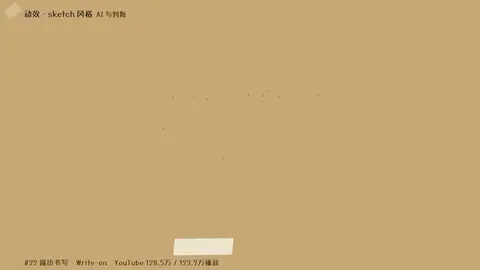
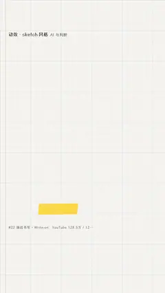

# `write_on` · 描边书写 → 填色 (Trim Paths on text / 手写签名)

 

**怎么动**：glyph outlines draw on, then the fill floods in.

| 项 | 内容 |
|---|---|
| 类别 | 字效 |
| 适合的句子 | 关键词、签名、毛笔字 |
| 建议时长 | 2–3 秒 |
| 参数 | `text` |
| 横屏 / 竖屏 | ✓ / ✓（尺寸用 vmin，竖屏自动缩放） |
| 人气依据 | YouTube 128.5万 / 123.7万播放 |

```json
{
 "scene": "fx",
 "fx": "write_on",
 "theme": "paper",
 "topic": "AI 与判断",
 "text": "判断",
 "line": "这一期只讲两个字：*判断*。",
 "host": true,
 "t": "@关键词"
}
```

**已知坑**：笔画描边依赖字体轮廓；毛笔字体（马善政）效果最好。
