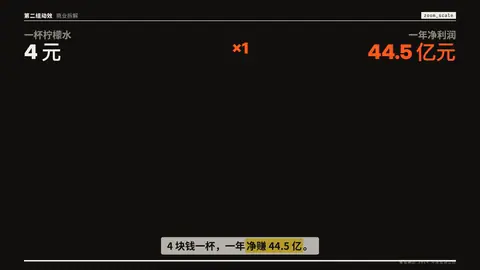
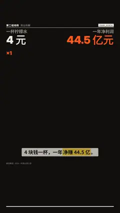

# `zoom_scale` · 十倍缩放

 

**怎么动**：两根柱子在同一个坐标上。坐标先停在能看清小的那根的位置，然后连续不停地按对数缩小——10 → 100 → 1,000……网格线一路往下滑、重新标数，大柱子还放不下时顶上写着「还高 N 倍」并跟着递减——直到小的那根缩成地上的一个点，大的那根终于在旁边完整放下。缩了几级，差距就是几个数量级。

| 项 | 内容 |
|---|---|
| 类别 | 数据 |
| 适合的句子 | 「4 块钱一杯，一年净赚 44.5 亿」差几个数量级的两个数 |
| 建议时长 | 5 秒左右 |
| 参数 | `a` `b`（都必填：{label, value, show}，b > a，至少相差 50 倍）、`unit`、`at`、`title`、`note` |
| 横屏 / 竖屏 | ✓ / ✓（竖屏：柱子从标签下一直到底边，刻度字只在字幕带上方；横屏同理） |
| 跟风格换皮 | 颜色只用风格的 token（--bg --fg --muted --accent --card --card-fg），字体用风格的 display / body / num；没写 `theme` 时画在风格自己的底色上 |
| 什么时候用 | 数量级差距本身是笑点 / 冲击点 |
| 什么时候不用 | 差距不到两个数量级（会报错，用 bars）；多于两个对象 |
| 同步口播 | 有字级时间戳（meta.words）时，条目 / 关键时刻落在说到它的那一刻；`at` 可以写 `"@词"` 或拍内秒数 |
| 缺内容 | 必填参数缺了会直接报错（不会画空骨架）；确实要骨架时写 `"skeleton": true` |

```json
{
 "scene": "fx",
 "fx": "zoom_scale",
 "topic": "商业拆解",
 "a": {
  "label": "一杯柠檬水",
  "value": 4,
  "show": "4 元"
 },
 "b": {
  "label": "一年净利润",
  "value": 4450000000,
  "show": "44.5 亿元"
 },
 "line": "4 块钱一杯，一年*净赚 44.5 亿*。",
 "src": "蜜雪集团 2024 年度业绩公告",
 "t": "@关键词"
}
```

**已知坑**：`show` 写显示用的数（如 "44.5 亿元"），value 写换算后的同单位数值。
